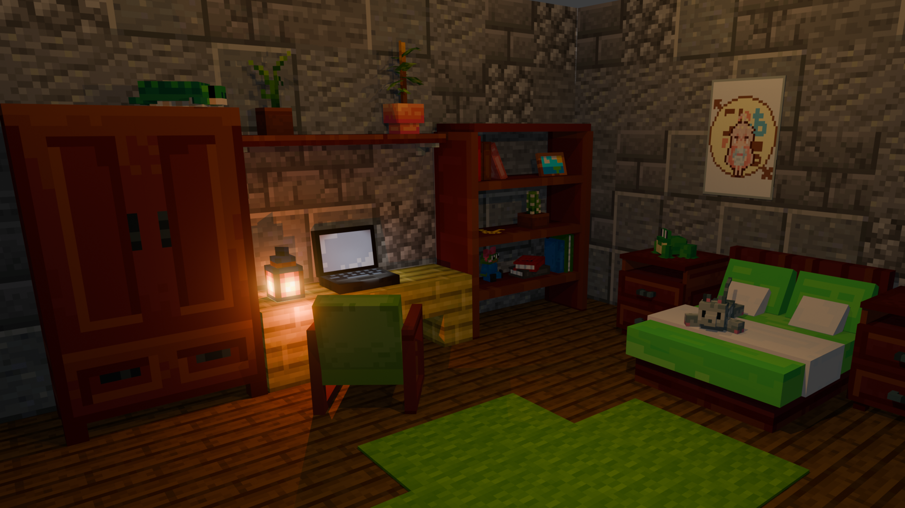

## Hi there  

I’m a junior C# developer.

My main programming language is C#. I also have experience in Python, Java, C++, JavaScript and HTML/CSS.
My current focus is backend development.

In the past, I worked on various hobby projects: 
- games in Unity and Godot (using C# in both)
- many Minecraft mods and plugins (Java)
- Backend in Python (FastApi) and C# (Asp.NET Core)
- Discord bots in Python
- frontend applications using React
- desktop applications for Windows

Some of my previous projects were not saved, and many others is private, as many of them are unfinished or experimental.

Through my game development experience I've also developed pretty solid pixel art skills, and can do some low poly 3d models. Example of my work is banner of this readme, I created it entirely myself using Blockbench for models and textures, and Blender for composition and final render.

I enjoy learning and trying new things, so for a long time I preferred prototyping and small to medium-sized projects.
Now I'm working on improving my ability to develop larger projects and bring them to a polished release state.

Open for collaboration.

---

Languages and Tools

